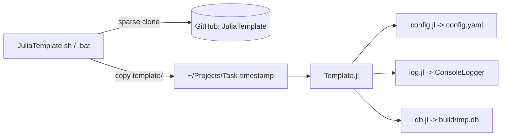

# julia-template: documentation hub

This repository holds a Julia project scaffold (`template/`) and two scripts,
`JuliaTemplate.sh` and `JuliaTemplate.bat`. The scripts copy the scaffold into a new
dated folder and run `git init` there. The repository README says the scaffold is for
coursework "where the write-up matters as much as the code" (`README.md`), so
`template/README.md` is a report outline, not a description of a program.

The requirements specification is in [../SPEC.md](../SPEC.md).

## Status

- Last commit to the project's own files (`template/`, the two scripts): `e103b17`,
  2026-11-07. It only changed line endings in `template/docs/make.jl`. The last change
  to the content was `d115faa`, 2025-03-31 (`JuliaTemplate.bat`) (`git log -- template JuliaTemplate.sh JuliaTemplate.bat`).
- Tests: `template/test/runtests.jl` exists but cannot pass as written (see
  "Known limitations"). Nothing in this repository runs it. The repository's own test
  verb, `.\recipe.ps1 test`, only runs pytest and ruff over `.claude` (`recipe.ps1:41-55`).
- CI: the stamped project gets `template/.github/workflows/ci.yaml`. It runs a file that
  does not exist. The lab workflows in `.gitea/workflows/` are standard tooling.
- Unfinished: the repository README has a "What does not work yet" section (`README.md`).
  `template/README.md` marks several chapters "(not implemented)".

## Layout

| Path | What it is |
|---|---|
| `JuliaTemplate.sh` | Bash script that stamps out a new project (Linux/macOS) |
| `JuliaTemplate.bat` | The same for Windows (cmd) |
| `template/Project.toml` | Julia project file: name `Template`, version 0.1.0, dependencies |
| `template/config.yaml` | One key, `name: 'Template'` |
| `template/src/Template.jl` | Module `Template` with `main()`. `main()` prints the configured name |
| `template/src/jl/jl.jl` | Includes `config.jl`, `log.jl` and `db.jl` |
| `template/src/jl/config.jl` | Loads `config.yaml` and sets `config_name` |
| `template/src/jl/log.jl` | Sets a `ConsoleLogger` as the global logger and logs one `@info` line |
| `template/src/jl/db.jl` | Creates `build/` and opens the SQLite file `build/tmp.db` |
| `template/src/jl/lib/install.jl` | Adds the listed packages with `Pkg.add`, then instantiates and precompiles |
| `template/src/jl/lib/datascience.jl` | `using` lines for data-science packages (DataFrames, CSV, Makie, MLJ, …) |
| `template/src/notebook.ipynb` | Julia notebook that includes the two `lib` files and reads `games.csv` |
| `template/test/runtests.jl`, `cover.jl`, `prof.jl` | Test set, LCOV coverage writer, PProf profiler run |
| `template/docs/make.jl`, `docs/src/index.md` | Documenter.jl build with a one-line index page |
| `template/Dockerfile`, `.dockerignore` | Image based on `julia:1.9` that runs `Pkg.test()` at build time |
| `template/.github/workflows/ci.yaml` | GitHub Actions job for the stamped project |
| `template/README.md` | Report skeleton (chapters, NFR table, architecture decision mermaid) |
| `template/LICENSE.txt` | The licence a stamped project starts with |

## Architecture

There are two parts that never run together:

1. **Stamping** (`JuliaTemplate.sh` / `.bat`). The script makes a sparse, depth-1,
   treeless clone of `https://github.com/IGORSVOLOHOVS/JuliaTemplate.git` into a
   temporary folder and checks out only `template/`. It copies the contents of
   `template/` to `~/Projects/Task-<YYYYMMDD-HHMMSS>` (`%USERPROFILE%\Projects\…` on
   Windows) and runs `git init`. Then it opens the folder in VS Code and deletes the
   temporary clone (`JuliaTemplate.sh:4-39`). The script copies from GitHub, not from
   the local checkout.
2. **Stamped project** (`template/`). Loading module `Template` runs `config.jl`,
   `log.jl` and `db.jl` at include time. These steps read `config.yaml`, set the logger
   and open `build/tmp.db`, all with paths relative to the current directory.
   `main()` prints `config_name` (`template/src/Template.jl:1-10`).



## Build and run

Prerequisites: `git` with sparse-checkout support, network access to GitHub, and
optionally VS Code on `PATH` (`JuliaTemplate.sh:17-35`). On Windows the script also
needs `wmic` (`JuliaTemplate.bat:4-9`). The stamped project needs Julia. The versions
in its files disagree: 1.9 in `template/Dockerfile:1` and `ci.yaml:18`, `Test = "1.11.0"`
in `template/Project.toml:21`, and kernel `Julia 1.11.0-rc3` in `template/src/notebook.ipynb` metadata.

Stamp a project (source: `README.md`):

```bash
./JuliaTemplate.sh          # Linux and macOS
JuliaTemplate.bat           # Windows
```

Inside a stamped project, the commands that appear in its files are:

| Command | Source |
|---|---|
| `julia -e 'using Pkg; Pkg.activate("."); Pkg.instantiate()'` | `template/.github/workflows/ci.yaml:21` |
| `julia src/jl/lib/install.jl` (inference: the file calls `Pkg.activate(".")`, so it must run from the project root) | `template/src/jl/lib/install.jl` |
| `docker build -t julia-logger .` / `docker run -p 8000:8000 -p 514:514 julia-logger` | `template/Dockerfile:12-13` (comments) |

## Configuration

| Name | Meaning | Default / source |
|---|---|---|
| `config.yaml` → `name` | Value that `main()` prints | `'Template'` (`template/config.yaml:1`) |
| `repoURL` | Repository the scripts clone | the GitHub URL (`JuliaTemplate.sh:7`, `.bat:22`) |
| `targetDir` | Destination of the copy | `$HOME/Projects/Task-<datestamp>` (`JuliaTemplate.sh:11`) |

The scripts take no CLI flags and read no environment variables except `HOME`,
`USERPROFILE` and `TEMP`. The module reads no environment variables.

## Usage

1. Run the stamping script. It prints `Script completed successfully.  Project directory: <path>`
   (`JuliaTemplate.sh:41`). On Windows it then waits for a key (`pause`).
2. In the new folder, fill in `template/README.md`'s chapters, edit `config.yaml`, and
   put code under `src/`.
3. Inference from the notebook's cells: to use the notebook, place a `games.csv` next to it.
   The file is not in the repository, and `.gitignore` excludes `*.csv`.

## Testing

- `template/test/runtests.jl` is one `@testset` that calls `Template.main()` and then
  `@test true`. It has no `using Template` (`template/test/runtests.jl:1-6`).
- `template/test/cover.jl` processes `src`, `test`, `docs` and `build` with Coverage.jl
  and writes `coverage.info`.
- `template/test/prof.jl` profiles `Template.main()` and opens `pprof()`.
- Nothing in this repository runs these files. `.\recipe.ps1 test` covers only `.claude`.

## Known limitations

From `README.md` "What does not work yet", checked against the files:

- `runtests.jl` uses `Template` without `using Template`, so it fails with `UndefVarError`.
- `ci.yaml:24` runs `src/jl/cov.jl`. The file does not exist; the coverage script is `test/cover.jl`.
- `prof.jl` uses `PProf`, which is not in `Project.toml` (it is in `install.jl:6`).
- Julia 1.9 in `Dockerfile` and `ci.yaml` against `Test` compat 1.11.0 in `Project.toml`.

Found while writing this document; the README does not list them:

- `datascience.jl` loads eight non-standard packages that `Project.toml` does not declare (DataFrames, CSV, Makie, GLMakie, Distributions, MLJ, Clustering, StatsBase), plus the standard libraries Statistics, Random and LinearAlgebra.
- `Project.toml` declares `ArgParse`, `Revise`, `PackageCompiler` and `SyslogLogging`, but no `.jl` file uses them.
- `.dockerignore` excludes `test/`, while the `Dockerfile` runs `Pkg.test()`. Inference: the image build cannot find `test/runtests.jl`.
- The `Dockerfile` exposes ports 8000 and 514, but no code opens a socket.
- `ci.yaml` triggers on branch `main`. `git init` in the scripts does not set a branch name.
- `config.jl` and `db.jl` use paths relative to the current directory, and they run when the module loads.
- `JuliaTemplate.bat:80` calls `code.cmd` without checking for it. The `.sh` checks first.

## Repository tooling

The repository follows [repo-quality-template](https://github.com/IGORSVOLOHOVS/repo-quality-template).
The README states compliance with lab requirements revision 4.0.0, with exceptions
R-02, R-09, R-13, R-37, R-41 and R-42 (`README.md`, "Lab requirements"). What is specific here (`recipe.ps1:9-23`):

- `$Name = 'julia-template'`, `$Code = 'jt2'`, `$Version = '1.1.0'`, `$Needs`/`$Tools`
  empty. There is no `$App`/`$Entry`, and `$Provides = @()`: nothing is installed or provided.
- Verbs that do something: `test` (pytest + ruff over `.claude` only; pytest exit 5,
  "no tests", passes), `info`, `clean` (deletes caches). `build`, `install`, `uninstall`,
  `run` and `publish` print `nothing to <verb>`.
- Deviations: `.claude/.env` is not committed, which reverses R-02 (`CLAUDE.md`, rule 4).
  No Julia tool is wired into the gates.

## Related documents

- [../README.md](../README.md): repository overview and known problems
- [../SPEC.md](../SPEC.md): requirements specification
- [../CLAUDE.md](../CLAUDE.md): working rules for this repository
- [../template/README.md](../template/README.md): report skeleton for stamped projects
- [../template/docs/src/index.md](../template/docs/src/index.md): Documenter index page
- [../LICENSE](../LICENSE), [../template/LICENSE.txt](../template/LICENSE.txt)

## About this document

Written 2026-11-18 from commit `26fc43e` (branch `release`). Commands run: `git ls-files`,
`git log` (whole repository and own paths), `git show --stat e103b17`, a JSON read of the
notebook's code cells, and `grep` for package usage. Not run: the stamping scripts (they
clone from the network and create folders in the home directory), Julia (not installed
on the machine that wrote this), `Pkg.test`, `docker build`, `.\recipe.ps1`.
